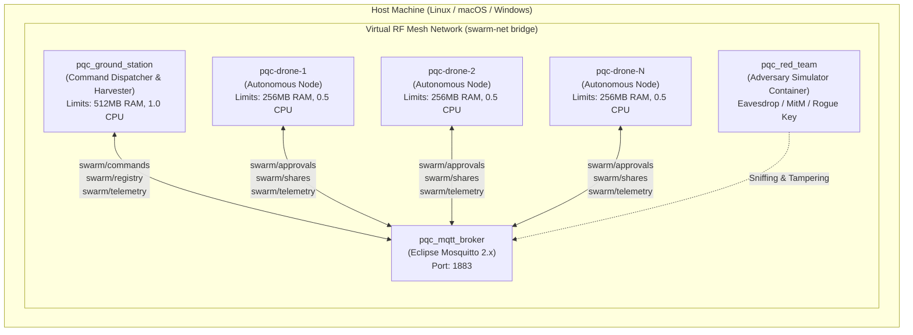

# Docker Simulation & Command Reference Guide

**Project:** Post-Quantum Cryptographic (PQC) Drone Swarm Coordination & Threshold Authorization  
**Repository:** `https://github.com/Aj-Shaer07/pqc.git`  
**Document Purpose:** Technical Reference for Swarm Emulation & Security Verification

---

## 1. Executive Summary & Hardware Simulation Rationale

Physical flight testing of autonomous drone swarms is costly, logistically complex, and hazardous—especially when validating cryptographic failure modes and adversarial attacks.

To evaluate real-world feasibility on resource-constrained embedded computing hardware without requiring physical UAVs, this project containerizes each network participant using **Docker** and **Docker Compose**:



### Why This Emulation Accurately Models Physical UAV Swarms:
1. **Isolated Operating Environments:** Every drone container runs inside an independent Linux network namespace, maintaining its own keypair, nonces, local state tables, and Shamir share.
2. **Hardware Resource Throttling:** Using Linux cgroups, each drone container is constrained to **256MB RAM** and **0.5 CPU cores** (matching low-cost companion computers such as the Raspberry Pi Zero 2W or Pixhawk companion computers).
3. **Virtual RF Mesh Broadcast (`swarm-net`):** The isolated Docker bridge network acts as the shared wireless frequency band. All communications transit via the Eclipse Mosquitto MQTT broker functioning as the virtual gossip fabric.
4. **Adversarial Red-Team Injection:** Attack containers can join the virtual network dynamically to sniff traffic, tamper with wire packets, or attempt unauthorized command execution.

---

## 2. Quick Command Reference

All operations are automated through the unified controller script:

```bash
./docker_commands.sh [COMMAND] [OPTIONS]
```

| Command | Syntax | Description |
| :--- | :--- | :--- |
| **`build`** | `./docker_commands.sh build` | Compiles dependencies and builds the base `pqc-drone-swarm:latest` Docker image. |
| **`test`** | `./docker_commands.sh test` | Runs the automated 24-test cryptographic, network, and multi-operator test battery inside an isolated container. |
| **`simulate`** | `./docker_commands.sh simulate [OPTIONS]` | Runs complete Phase 3.2 simulation across host CPU cores (Table 1 multi-scale sweep, Table 2 hardware tiers, Table 3 7-vector Red-Team attacks) and auto-exports `benchmark_results.csv` and `benchmark_results.json`. |
| **`cluster-sweep`** | `./docker_commands.sh cluster-sweep [SCALES] [ROUNDS]` | Runs live multi-container cluster benchmark sweep across scales (n = 10..50) with clean teardown per scale, exporting directly to CSV and JSON. |
| **`up`** | `./docker_commands.sh up [N] [MEM] [CPUS]` | Spawns the live swarm cluster with 1 Mosquitto Broker, 1 Ground Station, and N Drones with custom CPU/RAM limits. |
| **`logs`** | `./docker_commands.sh logs` | Streams real-time decentralized consensus logs across all containers. |
| **`attack`** | `./docker_commands.sh attack [MODE] [DUR] [TARGET]` | Injects Red-Team attack scenarios: `demo`, `eavesdrop`, `wrong-key`, `tamper`, `replay`, `rogue-gs`, `geofence`, or `multi-sig`. |
| **`attack geofence`** | `./docker_commands.sh attack geofence` | Injects out-of-bounds rogue waypoint commands; asserts drones autonomously reject via pre-voting signed AAD ingress filter. |
| **`attack multi-sig`** | `./docker_commands.sh attack multi-sig` | Injects full matrix of multi-operator permutations (1-of-3 sub-quorum, duplicate replay, hybrid forgery, corrupted sig, 2-of-3 quorum) into live swarm. |
| **`plot`** | `./docker_commands.sh plot` | Generates all 19 publication-quality comparative benchmark plots into `paper/result/`. |
| **`sim-single`** | `./docker_commands.sh sim-single` | Runs a standalone benchmark simulation round (k=3, n=5) inside Docker. |
| **`sim-all`** | `./docker_commands.sh sim-all [RUNS]` | Runs the full paper benchmark matrix across (3,5), (5,10), (10,20), (25,50). |
| **`down`** | `./docker_commands.sh down` | Gracefully terminates and removes all containers, networks, and volumes. |

---

## 3. Command Deep-Dive & Technical Mechanics

---

### 3.1 `build` — Base Image Compilation
```bash
./docker_commands.sh build
```

#### What It Does:
- Reads the multi-stage [Dockerfile](file:///home/aj-shaer/Desktop/pqc/Dockerfile) based on Debian Slim (`python:3.14-slim`).
- Installs minimal C-compiler toolchains (`build-essential`).
- Pre-installs optimized cryptographic libraries (`cryptography`, `pycryptodome`, `numpy`, `paho-mqtt`, `beartype`).
- Performs an editable install (`pip install -e`) of:
  - `falcon_py/`: Thomas Prest's post-quantum Falcon-512 reference implementation.
  - `pqc-drone-swarm/`: The modular drone swarm library.
- Produces a lightweight, self-contained Docker image tagged `pqc-drone-swarm:latest`.

---

### 3.2 `test` — Ephemeral Container Verification
```bash
./docker_commands.sh test
```

#### What It Does:
- Spawns a disposable container (`docker run --rm`) that executes Python's unit test runner against [tests/test_swarm.py](file:///home/aj-shaer/Desktop/pqc/pqc-drone-swarm/tests/test_swarm.py).
- **Validates 18 Security & Hardening Subsystems:**
  1. Falcon-512 digital signature generation and verification.
  2. CSPRNG Shamir's Secret Sharing polynomial evaluation over $p = 2^{521} - 1$.
  3. Lagrange polynomial interpolation at $x=0$ for key reconstruction.
  4. ChaCha20-Poly1305 AEAD authenticated encryption and tamper detection.
  5. Anti-Replay temporal freshness window ($\pm 5.0\text{s}$).
  6. Replay attack rejection on Ground Station commands.
  7. Replay attack rejection on peer drone approvals.
  8. Autonomous performance metrics profiling per drone.
  9. Decentralized swarm consensus simulation round ($k=3, n=5$).
  10. Wire confidentiality: zero plaintext $(x, y)$ leakage in `ShareMessage.to_dict()`.
  11. Broadcast encryption: passive eavesdroppers unable to reconstruct secret.
  12. Active tampering: bit-flipped ciphertexts and incorrect keys rejected.
  13. Shamir coordinate bounds validation ($1 \le x < p$, $0 \le y < p$), $x=0$ secret-leakage rejection, and duplicate $x$-coordinate detection preventing Lagrange division-by-zero.
  14. Defensive AEAD parameter bounds: strict 32-byte key, 12-byte nonce, and $\ge 16$-byte MAC tag enforcement.
  15. Anti-replay bounded memory eviction: hard entry cap protection against flood DoS within the freshness window.
  16. DroneNode single-drone share inflation quota enforcement: prevents a compromised node from single-handedly satisfying threshold $k$.
  17. Decoupled dual-threshold authorization architecture: strict share release gating behind approval quorum $k_a$ and secret reconstruction at Shamir threshold $k_s$.
  18. MQTT transport wire payload limit enforcement (128 KB ceiling) protecting companion microcomputers from RAM exhaustion.

---

### 3.3 `simulate` — Comprehensive Phase 3.2 Evaluation Matrix & Automated CSV/JSON Export

```bash
# Full Comprehensive Sweep (All scales n=10..50, 4 profiles, 5 loss rates, Table 2 hardware, Table 3 attacks)
./docker_commands.sh simulate

# Quick Sanity Smoke Test (1 trial per configuration across all scales, hardware, and attacks)
./docker_commands.sh simulate --quick

# Focused Scale Run with custom repetitions (e.g. n=10, 2 runs)
./docker_commands.sh simulate --scales 10 -r 2

# Custom Single Configuration: n=10, ka=7, ks=4, 10% loss, 100 trials
./docker_commands.sh simulate 10 7 4 0.10 100

# Live Multi-Container Cluster Benchmark Sweep across scales with automatic teardown
./docker_commands.sh cluster-sweep
./docker_commands.sh cluster-sweep 10
```

#### What `simulate` Does:
- **Zero Python Commands Required:** A single bash invocation coordinates the containerized benchmarking suite inside Docker.
- **Table 1: Multi-Scale Swarm Scalability & Timing Breakdown:**
  - Evaluates 4 standardized profiles (Legacy Baseline, Dual-Threshold Balanced, High-Availability, Strict) across fleet sizes n = 10, 20, 30, 40, 50.
  - Sweeps 5 stochastic RF packet loss rates (0%, 5%, 10%, 15%, 20%) with radio jitter (5-35 ms).
  - True distributed parallel latency modeling across host CPU worker processes.
- **Table 2: Embedded Hardware Constraint Scaling:**
  - Evaluates across 3 embedded companion tiers: Micro-UAV (0.25 core, 128MB RAM), Tactical Quadrotor (0.50 core, 256MB RAM), and Swarm Leader (1.00 core, 512MB RAM).
- **Table 3: Red-Team Adversarial Attack Resilience Battery:**
  - Validates active containment against 5 attack vectors: Passive Eavesdropping, Ciphertext Tampering, Wrong-Key Injection, Temporal Replay, and Rogue Ground Station Forgery.
- **Volume-Mounted Automated Export:**
  - Writes directly to [benchmark_results.csv](file:///home/aj-shaer/Desktop/pqc/benchmark_results.csv) (all 27 columns) and [benchmark_results.json](file:///home/aj-shaer/Desktop/pqc/benchmark_results.json).

---

### 3.4 `cluster-sweep` — Live Multi-Container Swarm Benchmark
```bash
# Default: runs n = 10, 20, 30, 40, 50 across 4 profiles and 5 loss rates (10 rounds each) with teardown
./docker_commands.sh cluster-sweep

# Single scale live container run (e.g. n = 10 drones, 10 rounds)
./docker_commands.sh cluster-sweep 10 10
```

- **Physical Container Isolation:** Starts N real autonomous drone containers, 1 Ground Station container, and 1 Mosquitto MQTT broker container per scale.
- **Sequential Lifecycle & Clean Teardown:** Evaluates one fleet size at a time, measures real Mosquitto MQTT bridge consensus latency, appends results to CSV and JSON, and cleanly tears down all containers (`docker compose down`) before advancing to the next scale.
- **Default Statistical Rigor:** Runs 10 consensus rounds per configuration (matching the default 10 iterations of `./docker_commands.sh simulate`).

---

### 3.4 `up` — Launching the Live Multi-Container Swarm
```bash
# Default: 5 Drones, 256MB RAM per drone, 0.5 CPU cores
./docker_commands.sh up

# Custom: 10 Drones, 512MB RAM, 1.0 CPU cores
./docker_commands.sh up 10 512m 1.0
```

#### What Happens Step-by-Step on Docker:
1. **Bridge Mesh Creation:** Docker creates the virtual isolated bridge network `swarm-net`.
2. **Broker Startup (`pqc_mqtt_broker`):** Mosquitto broker starts on port `1883`, listening for swarm traffic.
3. **Ground Station Daemon (`pqc_ground_station`):**
   - Generates its Falcon-512 public/private keypair.
   - Broadcasts its Falcon public key over `swarm/registry`.
4. **Autonomous Drone Nodes (`pqc-drone-1` to `pqc-drone-N`):**
   - Each drone container starts [run_drone_node.py](file:///home/aj-shaer/Desktop/pqc/pqc-drone-swarm/run_drone_node.py).
   - Generates its own local Falcon-512 keypair.
   - Subscribes to `swarm/registry`, `swarm/commands`, `swarm/approvals`, and `swarm/shares`.
   - Broadcasts its public key over `swarm/registry`.
5. **Decentralized Share Assignment:** Ground Station assigns a Shamir share coordinate $(x, y)$ to each discovered drone.
6. **Command Dispatch:** Ground Station encrypts a mission payload with ChaCha20-Poly1305, signs the digest with Falcon-512, and broadcasts it on `swarm/commands`.
7. **Local Verification & Approval Gossip:** Each drone independently validates the Ground Station's signature and freshness, creates a signed `ApprovalMessage`, and gossips it on `swarm/approvals`.
8. **Threshold Trigger & Broadcast Share Exchange:** Once a drone collects $\ge k$ valid peer approvals, it releases its ChaCha20-Poly1305 encrypted share on `swarm/shares`.
9. **Decentralized Key Reconstruction & Execution:** Each drone accumulates $k$ shares, decrypts them via the Swarm Mesh Key ($K_{\text{mesh}}$), reconstructs the 256-bit symmetric mission key via Lagrange interpolation, decrypts the mission payload, and executes the mission command locally.
10. **Telemetry Harvester:** Drones publish their execution acknowledgments and sub-millisecond latency profiles to `swarm/telemetry`.

---

### 3.5 `logs` — Inspecting Swarm Consensus in Real-Time
```bash
./docker_commands.sh logs
```

#### Key Decentralized Protocol Log Signatures:
- **Ground Station Broadcast:**
  `[GS] 🔒 Encrypting (ChaCha20-Poly1305) and signing (Falcon-512) mission command...`
- **Drone GS Verification:**
  `[DRONE_1] ✅ Verified GS Falcon signature in 2.14ms. Broadcasting approval...`
- **Peer Approval Gossip:**
  `[DRONE_2] Verified approval from DRONE_1 in 1.85ms. (Total: 3/3)`
- **Broadcast Share Emission:**
  `[DRONE_1] 🎯 Threshold 3 met for approvals! Broadcasting Shamir share (🔒 AEAD Encrypted)...`
- **Local Reconstruction & Execution:**
  `[DRONE_2] ⚡ All threshold conditions satisfied! Reconstructing key and executing payload locally...`
  `[DRONE_2] 🏆 SUCCESS: Executed mission payload: {'action': 'MISSION_RECON', ...}`
- **Security Alert Telemetry (upon attack injection):**
  `[GS] 🚨 SECURITY ALERT from DRONE_3: SHARE_REJECTED (Invalid signature from peer DRONE_1)`

---

### 3.6 `attack` — Red-Team Security & Adversary Simulator
```bash
./docker_commands.sh attack [MODE] [DURATION] [TARGET]
```

The empirical testing harness executes six active and passive attack scenarios against the live cluster or standalone runtime:

#### Mode 1: `attack demo` — Comprehensive Multi-Vector Test Battery
```bash
./docker_commands.sh attack demo
```
- **Execution:** Automated standalone battery executing all 5 threat models against a $(3, 5)$ swarm in memory.
- **Empirical Output:**
  - Evaluates wire secrecy: computes Shannon entropy ($H \approx 6.88$ bits/byte) on encrypted shares.
  - Verifies rogue node AEAD tag validation failure across all peer shares.
  - Tests active bit-flipped ciphertext injection against multiple nodes ($D_1, D_2, D_3$).
  - Validates `AntiReplayFilter` state rejection on replayed share packets.
  - Confirms unauthorized Ground Station command rejection.

---

#### Mode 2: `attack eavesdrop` — Wire Sniffing & Cryptanalytic Entropy Analysis
```bash
./docker_commands.sh attack eavesdrop 30
```
- **Execution:** An unauthenticated container connects to `swarm-net` and sniffs `swarm/commands` and `swarm/shares`.
- **Empirical Output:**
  - Quantifies Shannon entropy of in-flight ciphertexts ($H \approx 7.99$ bits/byte).
  - Inspects network dictionaries: coordinates $x$ and $y$ are completely absent from wire packets.
  - Evaluates Lagrange reconstruction: demonstrates $0$ recoverable coordinate points and $0 / 256$ leaked mission key bits under the Dolev-Yao wire sniffer model.

---

#### Mode 3: `attack wrong-key` — Rogue Node Key Mismatch & Injection Defense
```bash
./docker_commands.sh attack wrong-key 30
```
- **Execution:** Injects a rogue drone container into `swarm-net` with an invalid `SWARM_MESH_KEY` (`0000...`).
- **Empirical Output:**
  - **Ingress Isolation:** When honest drones broadcast shares, the rogue node attempts decryption; ChaCha20-Poly1305 raises an authentication tag failure (`InvalidTag`), preventing share accumulation.
  - **Egress Rejection:** The rogue node broadcasts a forged share onto `swarm/shares`. Receiving Docker drone nodes verify with their honest mesh key, detect the authentication failure, drop the packet, and broadcast `SECURITY_ALERT` telemetry.

---

#### Mode 4: `attack tamper` — Active MitM Ciphertext Modification
```bash
# Tamper with shares from any broadcasting drone
./docker_commands.sh attack tamper 30 all

# Tamper specifically with shares from Drone 2 (supports aliases: DRONE_2, drone-2, 2)
./docker_commands.sh attack tamper 30 DRONE_2
```
- **Automatic Container Alias Resolution:** The CLI automatically resolves human-readable container aliases (`DRONE_2`, `drone-7`, `2`, `10`) to the underlying container ID hash (`DRONE_91ef21ba`, `DRONE_7cd8540b`) using exact regex matching, avoiding collisions between nodes like `drone-1` and `drone-10`.
- **Execution:** Intercepts legitimate in-flight share broadcasts on `swarm/shares`, flips bits in `ciphertext_hex`, and re-injects the corrupted packet into the mesh.
- **Empirical Output:**
  - Receiving drone containers invoke `receive_share()` and drop the packet at two cryptographic layers:
    1. **Falcon-512 Digital Signature:** Digest mismatch over altered ciphertext bytes (Falcon C library returns signature squared norm error).
    2. **Poly1305 AEAD MAC Tag:** Decryption raises `InvalidTag`.
  - Recipient containers emit `SECURITY_ALERT` events (`alert_type: SHARE_REJECTED`) on `swarm/telemetry`, captured and confirmed by the attack harness (e.g. 9/9 live Docker rejections across the rest of a 10-node swarm).
  - Even after local command execution threshold $k$ is satisfied, continuous IDS validation inspects all subsequent peer shares and alerts on corrupted traffic without double-executing payloads.

---

#### Mode 5: `attack replay` — Temporal Replay Attack against Sliding Window
```bash
./docker_commands.sh attack replay 30
```
- **Execution:** Intercepts an authentic, validly signed packet, waits for honest nodes to process it, and re-broadcasts the exact original packet onto the mesh.
- **Empirical Output:**
  - Packet possesses a 100% valid Falcon-512 signature and valid Poly1305 MAC tag.
  - Honest drone nodes query their local `AntiReplayFilter` state:
    `Replay detected: identifier 'SHARE:cmd-replay:DRONE_1' already processed`
  - Duplicate is dropped; recipient nodes report `SECURITY_ALERT` telemetry; zero redundant executions occur.

---

#### Mode 6: `attack rogue-gs` — Unauthorized Command Forgery
```bash
./docker_commands.sh attack rogue-gs 20
```
- **Execution:** Broadcasts a forged mission command onto `swarm/commands` signed with an unrecognized Falcon-512 keypair.
- **Empirical Output:**
  - Drones verify against the pinned `gs_public_key` in their trust registry:
    `Invalid Falcon-512 GS signature`
  - Rejection is logged and reported via `SECURITY_ALERT` telemetry; zero approvals or shares are emitted by the swarm.

---

#### Mode 7: `attack geofence` — Autonomous Geofence & Boundary Enforcement
```bash
./docker_commands.sh attack geofence 20
```
- **Execution:** Injects a mission command carrying a valid Ground Station signature but instructing an out-of-bounds tactical waypoint (e.g. Lat 39.50°N, Lon -119.80°W, >210 km away from authorized operational envelope `[37.0°N to 38.5°N, 123.0°W to 121.5°W]`).
- **Empirical Output:**
  - Drones inspect unencrypted Associated Authenticated Data (AAD) flight manifest **before generating approval votes**.
  - `validate_geofence()` detects the boundary violation, drops the command immediately, zeroizes temporary memory, and broadcasts `GEOFENCE_VIOLATION` alerts over `swarm/telemetry`.
  - Zero approval votes are released, preventing swarm consensus.

---

#### Mode 8: `attack multi-sig` — Multi-Operator Authorization Combinations Scorecard
```bash
./docker_commands.sh attack multi-sig 20
```
- **Execution:** Injects the full matrix of operational quorums and hostile permutation attacks into live Docker drone containers on `swarm-net`:
  1. **Sub-Quorum (1-of-3):** Signed only by Commander -> Drones reject (`1 < 2` operators).
  2. **Duplicate Replay Attack:** Double-signed by Commander twice (`[Commander, Commander]`) -> Drones reject (distinct operator set collapses to 1).
  3. **Hybrid Forgery Attack:** Signed by Commander + Unregistered Rogue Key -> Drones reject (unpinned key dropped).
  4. **Corrupted In-Transit Sig:** Signed by Commander + Bit-Flipped Safety -> Drones reject (Falcon verification failure).
  5. **Dual Quorum (Pair A):** Signed by Commander + Safety -> Drones accept (`2 >= 2`).
  6. **Flexible Quorum (Pair B):** Signed by Commander + Tactical Lead (Safety offline) -> Drones accept (`2 >= 2`).
- **Empirical Output:** Prints an interactive live scorecard summarizing all 6 combinations and confirmed telemetry alerts.

---

### 3.7 `plot` — High-Resolution Benchmark Visualization Suite
```bash
./docker_commands.sh plot
```
- Ingests `benchmark_results.csv`, `cluster_benchmark_results.csv`, and `benchmark_results.json`.
- Generates all 19 publication-quality comparative figures (DPI 300) directly into `paper/result/`:
  - `latency_vs_scale_loss_0pct.png` through `20pct.png`
  - `latency_vs_scale_all_loss_grid.png` (Master 5-Loss Grid)
  - `packet_loss_resilience_n10.png` through `n50.png`
  - `packet_loss_all_scales_grid.png` (Master All-Scales Grid)
  - `crypto_timing_breakdown_comparison.png`
  - `consensus_latency_decomposition.png`
  - `hardware_sensitivity_analysis.png`
  - `adversarial_resilience_analysis.png`
  - `rogue_gs_and_safety_defense.png` (Tactical Airspace Map, Microprocessor Multi-Sig Overhead, Threat Containment Scorecard)

---

### 3.8 Part 2: Dynamic Swarm Membership & Churn Handling (Under Active Development)
Covers mid-mission swarm lifecycle management:
1. **Cryptographic Node Revocation:** Broadcasts signed `RevocationNotice` to eject captured/rogue UAVs; drones drop revoked public keys and ignore future approvals/shares.
2. **Dynamic Replacement Onboarding (Zero Key-Reset):** Provisions replacement drones mid-flight by evaluating existing secret polynomial $f(x)$ over $2^{521} - 1$ at fresh index $x = n_{\text{new}}$, without rekeying active drones.
3. **Autonomous Return-to-Launch (RTL) on Quorum Collapse:** Peer heartbeat loop triggers autonomous RTL, zeroizing ephemeral shares when live active drones drop below $k_a$ or $k_s$.

---

### 3.9 `down` — Swarm Teardown
```bash
./docker_commands.sh down
```
- Gracefully stops all container processes (`SIGTERM` handling).
- Removes container namespaces and the virtual bridge network `swarm-net`.
- Zero residual artifacts left on the host.
