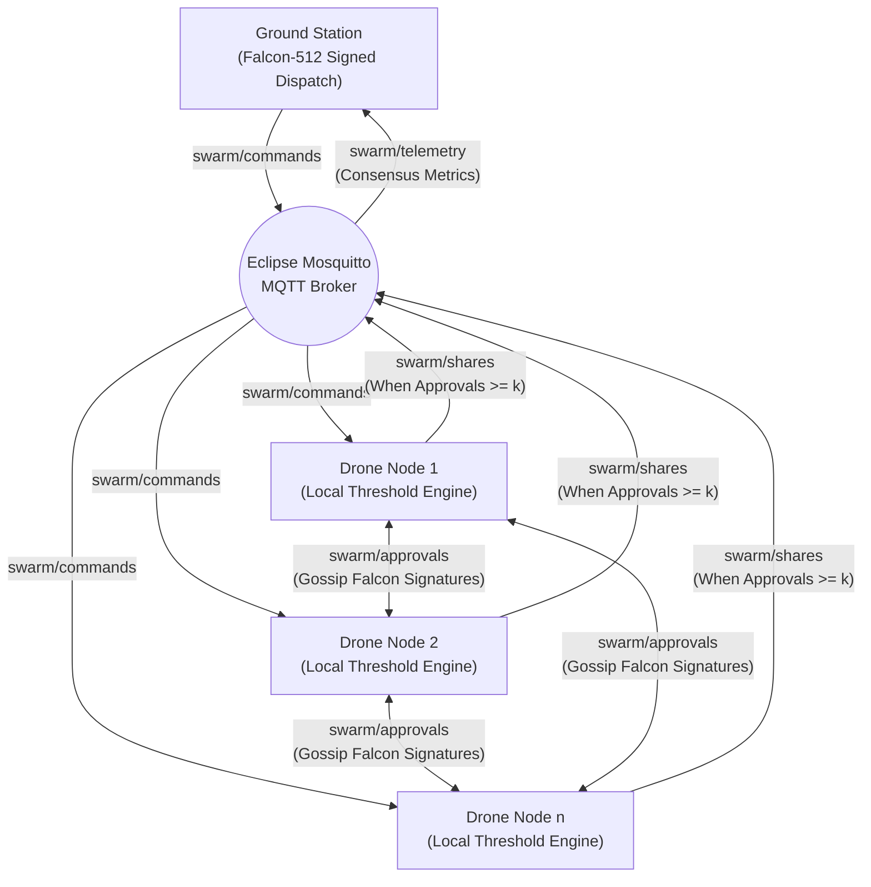

# Post-Quantum Cryptographic Drone Swarm — Technical Journal Implementation

**Target Venues:** IEEE Transactions on Information Forensics and Security (TIFS) / IEEE Transactions on Dependable and Secure Computing (TDSC) / IEEE Internet of Things Journal  
**Repository:** `https://github.com/Aj-Shaer07/pqc.git`  
**Document Purpose:** Architectural and functional specification of implemented protocol subsystems, cryptographic engines, communication channels, and containerized simulation framework.

---

## 1. System Overview & Problem Formulation

Unmanned Aerial Vehicle (UAV) swarms operating in tactical, surveillance, and disaster response scenarios rely on low-latency wireless communication over peer-to-peer mesh networks. Existing threshold command and control protocols typically depend on classical asymmetric cryptography (RSA, ECDSA, ECDH) and centralized coordination engines. These assumptions introduce two severe vulnerabilities:

1. **Quantum Threat (Shor's Algorithm):** Cryptanalytic quantum algorithms break finite field and elliptic curve discrete logarithm problems in polynomial time, compromising standard digital signatures and key exchanges.
2. **Single Point of Failure (Centralized Coordinators):** Centralized threshold engines can be physically targeted, jammed, or hijacked by an adversary to paralyze swarm operations.

To resolve these vulnerabilities, this project realizes a **Decentralized Post-Quantum Cryptographic (PQC) Swarm Coordination and $(k, n)$ Threshold Authorization Architecture**. Each UAV drone functions as an autonomous, self-verifying peer node within an isolated network topology.

---

## 2. Phase 0: Cryptographic Primitives & Core Packaging

Phase 0 establishes the foundational cryptographic building blocks and packages them into a modular Python architecture located in `src/pqc_swarm`. All algorithms operate in accordance with post-quantum security guarantees and authenticated cryptographic standards.

### 2.1 Falcon-512 Digital Signature Subsystem
- **Underlying Hardness:** Built upon the Short Integer Solution (SIS) problem over Ring-LWE and NTRU lattices, conforming to the NIST Post-Quantum Cryptography Standardization standard.
- **Role in Protocol:** Provides unforgeable, quantum-resistant message authentication for both Ground Station command dispatches and drone-to-drone peer approvals.
- **Properties & Performance:**
  - Public Key Size: $\sim 897$ bytes.
  - Signature Size: $\sim 666$ bytes.
  - Generates compact signatures with sub-millisecond verification overhead, optimal for micro-UAV compute and radio packet limits.
- **Implementation Wrapper:** `FalconSigner` in `src/pqc_swarm/crypto/falcon.py` provides high-level APIs for keypair generation, message digest signing, and cryptographic signature verification with fallback path resolution.

### 2.2 Hardened $(k, n)$ Shamir's Secret Sharing (SSS)
- **Mathematical Specification:** The master symmetric mission key $S$ is encoded as the secret constant term $a_0 = S$ of a random degree-$(k - 1)$ polynomial over the finite Mersenne prime field $\mathbb{F}_p$ where $p = 2^{521} - 1$:
  $$f(x) = S + \sum_{i=1}^{k-1} a_i x^i \pmod p$$
- **CSPRNG Generation:** To prevent pseudo-random prediction attacks, polynomial coefficients $a_1, \dots, a_{k-1}$ are generated via the cryptographically secure pseudo-random number generator (`secrets.randbelow`).
- **Horner's Evaluation Rule:** Polynomial evaluation at evaluation points $x \in \{1, \dots, n\}$ uses Horner's nested accumulation method:
  $$f(x) = (\dots((a_{k-1} x + a_{k-2}) x + a_{k-3}) \dots x + a_0) \pmod p$$
  This ensures optimal numeric stability and $O(k)$ computational efficiency per share.
- **Lagrange Polynomial Reconstruction:** A threshold subset of $k$ distinct shares $(x_j, y_j)$ reconstructs the mission key at $x = 0$ using Lagrange basis polynomials:
  $$S = \sum_{j=1}^{k} y_j \prod_{m \neq j} \frac{-x_m}{x_j - x_m} \pmod p$$
  Where modular inverses $\frac{1}{x_j - x_m} \pmod p$ are computed using Fermat's Little Theorem via modular exponentiation $\text{pow}(den, p - 2, p)$.
- **Implementation File:** `src/pqc_swarm/crypto/sss.py`.

### 2.3 ChaCha20-Poly1305 AEAD Symmetric Payload Confidentiality
- **Purpose:** Protects the confidentiality and integrity of operational UAV mission commands (e.g., waypoint coordinates, velocity vectors, payload drop triggers).
- **Security Mechanism:** Uses ChaCha20 stream cipher with a 256-bit key and 96-bit nonce, combined with the Poly1305 universal hash-based MAC to provide Authenticated Encryption with Associated Data (AEAD) as specified in RFC 8439.
- **Associated Authenticated Data (AAD):** Critical packet metadata (command ID, nonce, epoch timestamp) is included as associated data. This guarantees that any tampering with message headers causes authentication failure before decryption.
- **Implementation File:** `src/pqc_swarm/crypto/aead.py`.

### 2.4 Modular Layout & Benchmark Suite
- **Package Modernization:** Monolithic prototypes were decomposed into an installable Python package (`pqc_swarm`) with standardized entry points and typing definitions (`src/pqc_swarm/models`).
- **Benchmark Suite:** `run_simulation.py` executes automated cryptographic evaluations across $(k, n)$ threshold configurations: $(3,5)$, $(5,10)$, $(10,20)$, and $(25,50)$, measuring key generation latency, share generation time, and Lagrange interpolation throughput.

---

## 3. Phase 1: Decentralized Coordination & Networking Layer

Phase 1 eliminates all centralized coordinator bottlenecks, implementing an autonomous peer-to-peer threshold consensus protocol transported over an asynchronous MQTT network fabric.

### 3.1 Elimination of the Centralized Threshold Engine
In conventional designs, drones transmit their shares back to a central master node for validation. In this architecture:
- Each `DroneNode` embeds its own internal verification and reconstruction state.
- No single node possesses the master mission key prior to collaborative threshold agreement.
- Each drone independently collects, verifies, and tabulates peer Falcon signatures, independently triggering Shamir share publication and payload decryption once $k$ valid approvals are accumulated.

### 3.2 MQTT Swarm Communication Fabric
The communication layer uses MQTT (Message Queuing Telemetry Transport) over TCP as an asynchronous pub/sub transport bus (`SwarmMQTTTransport` in `src/pqc_swarm/networking/mqtt_client.py`).
- **Why MQTT?** MQTT provides lightweight packet headers, bi-directional topic-based filtering, and low CPU/network overhead. In a simulated mesh environment, the broker serves as a virtual broadcast medium where each topic corresponds to an isolated operational channel.
- **Reconnection & Resilience:** Handles automatic background event looping (`client.loop_start()`) and resilient exponential connection retries against network churn.

### 3.3 Swarm Topic Routing & Message Workflow

| Topic Channel | Sender | Receiver | Functional Purpose |
| :--- | :--- | :--- | :--- |
| `swarm/commands` | Ground Station | Swarm (All Drones) | Broadcasts mission commands containing ciphertext, 96-bit nonce, timestamp, AAD, and the Ground Station's Falcon-512 signature. |
| `swarm/approvals` | Drone Nodes | Peer Drones | Peer-to-peer gossip channel. Drones broadcast signed approval messages after verifying Ground Station signature and timestamp freshness. |
| `swarm/shares` | Drone Nodes | Peer Drones | Threshold share exchange. Once a drone receives $\ge k$ verified approvals for a command, it publishes its signed Shamir share $(x, y)$. |
| `swarm/registry` | Nodes / GS | Swarm (All Drones) | Trust discovery channel. Transmits node registrations and Falcon-512 public keys to populate local trust tables. |
| `swarm/telemetry` | Drone Nodes | Ground Station | Execution reporting. Reports mission execution acknowledgments and granular timing benchmarks (latency breakdowns). |

### 3.4 Operational Protocol Flow
1. **Command Ingestion:** Ground Station broadcasts a command on `swarm/commands`.
2. **Autonomous Verification:** Each drone receives the command, checks timestamp freshness against its anti-replay window, and validates the Ground Station's Falcon-512 signature using its local `TrustRegistry`.
3. **Approval Gossip:** Upon successful verification, the drone creates an `ApprovalMessage`, signs the message digest using its local Falcon private key, and broadcasts it on `swarm/approvals`.
4. **Approval Tabulation:** Each drone verifies incoming peer approvals against registered public keys and counts valid distinct signatures.
5. **Share Release:** When a drone's local count reaches the required threshold ($\ge k$ approvals), it generates a `ShareMessage` with its own $(x, y)$ coordinate, signs it, and broadcasts it on `swarm/shares`.
6. **Key Reconstruction & Execution:** Upon accumulating $k$ valid shares, the drone applies Lagrange interpolation to reconstruct the 256-bit symmetric key, decrypts the ChaCha20-Poly1305 ciphertext, verifies the Poly1305 MAC tag, executes the command, and publishes telemetry on `swarm/telemetry`.

### 3.5 Autonomous Daemon Architecture
- **`run_drone_node.py`:** Runs as an autonomous background daemon for each drone. It initializes the node's Falcon keypair, subscribes to MQTT topics, maintains internal caches, and reacts to network events.
- **`run_ground_station.py`:** Runs as the mission commander. It distributes keys, publishes mission commands, listens to the telemetry topic, and logs end-to-end consensus latencies across the swarm.

---

## 4. Phase 2: Multi-Container Hardware Simulation via Docker

Phase 2 provides a realistic, reproducible testbed by deploying the decentralized swarm inside multi-container Docker environments with simulated physical hardware constraints.

### 4.1 Containerized Node Isolation
- **Base Image:** `python:3.14-slim` Debian base containing compiled cryptographic packages (`pycryptodome`, `cryptography`, `numpy`, `paho-mqtt`) and editable installs of `falcon_py` and `pqc_swarm`.
- **Network Isolation:** All containers communicate exclusively over an isolated virtual bridge network (`swarm-net`), mimicking a shared RF mesh broadcast spectrum.
- **Multi-Container Composition:**
  - $1\times$ `pqc_mqtt_broker` container running Eclipse Mosquitto.
  - $1\times$ `pqc_ground_station` container.
  - $N\times$ `pqc-drone-N` autonomous drone containers.

### 4.2 Hardware Resource Throttling
Embedded flight computers (e.g., Raspberry Pi Zero, Pixhawk companion computers, STM32 microcontrollers) operate under severe compute and memory limitations. To replicate these operating conditions:
- **CPU Quotas:** Docker cgroups throttle container CPU allocation dynamically between `0.25`, `0.5`, and `1.0` cores.
- **RAM Caps:** Per-container memory footprints are constrained to `128m`, `256m`, and `512m` limits.
- **Observation:** Allows empirical evaluation of Falcon-512 polynomial sampling and Lagrange matrix operations under thermal and compute constrained conditions.

### 4.3 Orchestration & CLI Controller
- **`docker-compose.yml`:** Defines service profiles, bridge network bindings, port mappings (1883 for MQTT), and container scaling policies (`--scale drone=N`).
- **`docker_commands.sh`:** Provides a centralized CLI automation controller with standard operations:
  - `build`: Builds the unified PQC Docker image.
  - `test`: Executes the full test suite in an isolated container.
  - `sim-single`: Executes a standalone single-run benchmark.
  - `sim-all`: Evaluates multiple $(k, n)$ configurations sequentially.
  - `up [N] [MEM] [CPUS]`: Spawns $N$ throttled drone containers with custom hardware limits.
  - `down`: Tears down the virtual swarm mesh and prunes networks.
  - `logs`: Streams distributed telemetry and consensus logs.

---

## 5. Phase 3: Implemented Protocol Hardening & Telemetry Profiling

Phase 3 introduces cryptographic defenses against active network adversaries and instruments comprehensive performance profiling directly into the node runtime.

### 5.1 Temporal Freshness & Anti-Replay Defense
To defend against replay attacks (where an eavesdropping adversary records and retransmits valid historical packets):
- **Sliding Time Window:** The `AntiReplayFilter` (`src/pqc_swarm/crypto/anti_replay.py`) maintains a sliding validity window $W = \pm 5.0\text{ seconds}$ around local node time $t_{\text{now}}$.
  - Packets with $t_{\text{msg}} > t_{\text{now}} + W$ are rejected as future clock skew violations.
  - Packets with $t_{\text{msg}} < t_{\text{now}} - W$ are rejected as stale/expired.
- **Nonce & Identifier Caching:** Each message generates a unique tracking identifier:
  - Commands: `CMD:<command_id>:<nonce_hex>`
  - Approvals: `APP:<command_id>:<drone_id>`
- **Automatic TTL Pruning:** Valid identifiers are recorded in an in-memory hash table. When the cache exceeds capacity or when `cleanup()` is invoked, all identifiers older than $2 \times W$ ($10\text{ seconds}$) are pruned, keeping memory overhead $O(1)$ over sustained operations.

### 5.2 Broadcast Share Encryption & Wire Confidentiality
In distributed threshold schemes, broadcasting plaintext shares $(x, y)$ over shared mesh frequencies exposes the system to passive eavesdropping: an adversary monitoring MQTT traffic on `swarm/shares` can passively aggregate $k$ shares and independently reconstruct the master mission key without compromising any physical drone nodes.

To establish wire confidentiality, the protocol implements **ChaCha20-Poly1305 AEAD Broadcast Encryption**:
- **Swarm Mesh Session Key ($K_{\text{mesh}}$):** A 256-bit symmetric session key established across authorized swarm nodes and the Ground Station.
- **Payload Encapsulation:** When threshold approvals are achieved, the drone serializes its share coordinate pair `{"x": x, "y": y}` and encrypts it under $K_{\text{mesh}}$ with a fresh 96-bit CSPRNG nonce.
- **Associated Authenticated Data (AAD) Binding:** The AEAD operation cryptographically binds packet metadata:
  $$\text{AAD} = \text{SHARE} \parallel \text{id}_{\text{cmd}} \parallel \text{id}_{\text{drone}} \parallel t_{\text{msg}}$$
  This prevents cross-command replay, node identity spoofing, and splicing attacks.
- **Dual Cryptographic Protection:** The message payload is both AEAD encrypted (confidentiality & ciphertext integrity) and signed with Falcon-512 (origin authenticity & non-repudiation).
- **Zero Wire Leakage:** The serialized network payload (`ShareMessage.to_dict()`) completely omits $x$ and $y$ coordinate fields when encrypted, transmitting only `ciphertext_hex`, `nonce_hex`, and `timestamp`.
- **Receiver Validation & Rejection:** Receiving peers verify anti-replay freshness, authenticate the sender's Falcon-512 public key, and decrypt using $K_{\text{mesh}}$. Any unauthorized node without $K_{\text{mesh}}$ or any tampered ciphertext is rejected.

### 5.3 Performance Profiling & Distributed Telemetry Metrics
Every drone node precisely instruments execution phases using high-resolution performance counters (`time.perf_counter()`), transmitting metrics via `swarm/telemetry`:

1. **Ground Station Signature Verification Latency (`gs_verify_time_ms`):** Time spent validating Ground Station Falcon-512 signatures and message digests.
2. **Approval Generation Latency (`approval_create_time_ms`):** Time taken to compute local Falcon-512 signatures on approval digests.
3. **Peer Approval Verification Latency (`peer_verify_times_ms`):** Per-peer latency array measuring verification of incoming Falcon-512 signatures.
4. **Lagrange Reconstruction Latency (`reconstruct_time_ms`):** Duration of modular polynomial interpolation over $\mathbb{F}_p$ across $k$ shares.
5. **ChaCha20-Poly1305 Decryption Latency (`decrypt_time_ms`):** Symmetric authenticated decryption time for mission payloads.
6. **Total End-to-End Consensus Latency (`total_consensus_time_ms`):** Duration from Ground Station broadcast dispatch to decentralized payload execution on the drone:
   $$\Delta T_{\text{consensus}} = t_{\text{executed}} - t_{\text{dispatched}}$$

### 5.4 Empirical Red-Team Adversarial Test Battery & Live Telemetry
To transition from theoretical security proofs to empirical validation across independent container namespaces, the framework implements a live red-team adversary suite (`simulate_adversary.py`):

1. **Passive Wire Sniffing & Shannon Entropy Analysis:**
   - Intercepts in-flight commands and broadcast shares over `swarm/commands` and `swarm/shares`.
   - Computes empirical Shannon entropy $H(X) = -\sum P(x_i) \log_2 P(x_i) \approx 6.88$ to $7.99$ bits/byte, proving computational indistinguishability from random noise.
   - Evaluates cryptanalytic inversion: with 0 plaintext coordinate points exposed, Shamir polynomial reconstruction is strictly impossible ($0 / 256$ secret bits leaked).
2. **Rogue Node Key Isolation (Ingress & Egress):**
   - **Ingress:** Unauthorized containers with mismatched session keys attempt decryption of peer shares; ChaCha20-Poly1305 MAC tag failure (`InvalidTag`) blocks share collection.
   - **Egress:** Rogue nodes inject forged shares onto `swarm/shares`. Receiving Docker drone nodes verify with the authentic mesh key, detect MAC failure, drop the packet, and emit `SECURITY_ALERT` telemetry.
3. **Active MitM Ciphertext Modification:**
   - Injects bit-flipped ciphertexts onto `swarm/shares` targeting peer nodes.
   - Recipient drones enforce **Dual-Layer Rejection**:
     - *Layer 1 (Falcon-512):* Digital signature over altered digest is rejected.
     - *Layer 2 (Poly1305 AEAD):* Authentication MAC tag fails verification.
4. **Temporal Replay Attack Defense:**
   - Re-transmits authentic historical packets carrying 100% valid Falcon-512 signatures and valid AEAD ciphertexts.
   - Recipient nodes query `AntiReplayFilter` state and drop duplicates (`identifier already processed`), confirming that temporal state protects the swarm even if signatures remain valid.
5. **Unauthorized Ground Station Forgery:**
   - Broadcasts forged commands on `swarm/commands` signed with an unrecognized Falcon keypair.
   - Drones check the pinned Ground Station public key in their trust registry, reject the command, and emit `COMMAND_REJECTED` alerts.
6. **Anti-DoS Nonce Poisoning Protection:**
   - Freshness verification (`check_freshness()`) is strictly decoupled from state caching (`record_seen()`). Nonces are committed to cache only after signature authentication passes, preventing unauthenticated forgery packets from exhausting honest nonces.

### 5.5 Multi-Dimensional Cryptographic, Network & System Hardening

To guard against adversarial denial-of-service, mathematical corner cases, and network instability, the implementation incorporates three layers of hardening:

#### 1. Cryptographic Hardening
- **Shamir Prime Field Bounds & Non-Zero Invariance:** SSS shares $(x, y)$ are verified against $1 \le x < p$ and $0 \le y < p$. Specifically, evaluating $x=0$ yields $f(0) = S$, directly exposing the secret. Drones validate incoming shares using `validate_share()`, discarding any zero or out-of-field elements immediately.
- **Lagrange Coordinate Collision Defense:** Lagrange interpolation requires computing modular inverses $(x_j - x_m)^{-1} \pmod p$. If an adversary submits duplicate $x$ coordinates, the denominator vanishes ($x_j - x_m = 0$), causing fatal division-by-zero exceptions (`pow(0, -1, p)`). `reconstruct_secret()` validates pairwise uniqueness of $x$ coordinates prior to interpolation.
- **Single-Drone Share Inflation Quota:** In decentralized $(k, n)$ consensus, threshold $k$ must represent $k$ distinct peer drones. A compromised drone holding 1 valid Falcon keypair must not be permitted to broadcast multiple coordinate shares to meet threshold $k$ alone. Drones track `share_contributors: Dict[str, Set[str]]` and enforce a strict one-share quota per contributing peer drone.
- **Defensive AEAD Parameter Checking:** Enforces strict 32-byte keys, 12-byte nonces, and minimum 16-byte MAC tags in ChaCha20-Poly1305 routines. Malformed UTF-8 or corrupt JSON payloads trigger explicit cryptographic rejections rather than unhandled native crashes.

#### 2. Network Hardening
- **Wire Payload Size Bounding (128 KB Limit):** Constrained companion computers (e.g., 256MB RAM) are vulnerable to memory-bomb DoS attacks via oversized MQTT frames. `MAX_WIRE_PAYLOAD_BYTES = 128 * 1024` enforces a hard payload limit on both outbound publications and inbound message handlers, dropping oversized payloads prior to deserialization.
- **Thread Exception Isolation:** `paho-mqtt` dispatches message handlers on an internal background thread (`loop_start()`). Uncaught exceptions inside message callbacks can terminate the network thread without crashing the parent process, leaving the drone deaf to gossip. All message callbacks wrap handler invocations with defensive exception isolation, logging alerts without disrupting the network loop.
- **Broker Client ID Entropy:** Client IDs are suffixed with cryptographic entropy (`secrets.token_hex(4)`), preventing connection drops from client ID collisions on the Mosquitto broker.

#### 3. System & Concurrency Hardening
- **Reentrant State Mutexes (`threading.RLock`):** Drones process asynchronous network callbacks across multiple threads while simultaneously evaluating consensus timeouts. Mutex locks across `DroneNode`, `TrustRegistry`, and `AntiReplayFilter` protect internal dictionaries against race conditions and self-deadlocks.
- **Bounded Sliding-Window Cache:** `AntiReplayFilter` enforces `max_entries = 4096`. Under high-frequency flood DoS within the sliding time window, excess entries are evicted to maintain strict $O(1)$ memory consumption.

### 5.6 Dynamic $(k, n)$ Fleet Discovery & Continuous Intrusion Detection

- **Dynamic Cluster Discovery & Exact $(k, n)$ Allocation:**
  In practical field deployments, the active swarm fleet size $n$ fluctuates based on operational scale and container replica counts. The Ground Station implements dynamic fleet discovery over `swarm/registry`, aggregating registrations to determine the active cluster count $n = |\text{Registered Fleet}|$. Exact $(k, n)$ Shamir shares are then evaluated over $\mathbb{F}_p$ for $x \in \{1, \dots, n\}$ and assigned uniquely to each discovered drone, eliminating artificial static share pools. A synchronized cluster registry broadcast distributes all peer public keys and assigned coordinates to the fleet before mission dispatch, preventing untrusted-drone rejection cascades.
- **Continuous Intrusion Detection System (IDS) Share Validation:**
  In a $(k, n)$ threshold swarm where $k < n$ (e.g. $k=3, n=10$), honest nodes reach consensus rapidly upon receiving the first $k$ shares. However, an in-flight adversary may tamper with shares transmitted by remaining peers. The node architecture decouples mission execution from cryptographic packet inspection:
  - Every incoming share is continuously evaluated through the complete validation pipeline: Anti-Replay freshness $\to$ Falcon-512 digital signature $\to$ ChaCha20-Poly1305 MAC tag.
  - Corrupted or bit-flipped ciphertexts immediately generate distributed `SECURITY_ALERT` telemetry, ensuring 100% visibility over active RF mesh attacks even after local mission consensus has settled.
  - Local payload execution is guarded by an execution set, guaranteeing that the mission payload executes strictly once upon reaching threshold $k$.
- **Automated Container Alias Resolution in Adversary Evaluation:**
  To enable seamless testing across containerized topologies, the evaluation controller (`docker_commands.sh`) implements host-level container inspection with exact regex anchoring. Targeting commands like `./docker_commands.sh attack tamper 30 DRONE_2` automatically resolve to the target container's cryptographic identifier (`pqc-drone-2` $\to$ `DRONE_91ef21ba`), verifying targeted MitM interception and dual-layer cryptographic rejection across all 9 peer nodes in the running Docker cluster.

---

## 6. Structural Implementation Mapping

The following matrix maps the journal architecture directly to files in the repository:

| Architectural Component | Primary Source Files | Role & Responsibility |
| :--- | :--- | :--- |
| **Falcon-512 Signatures** | `src/pqc_swarm/crypto/falcon.py` `falcon_py/` | Post-quantum lattice signature generation, keypair generation, and verification. |
| **Shamir Secret Sharing** | `src/pqc_swarm/crypto/sss.py` | Prime field polynomial evaluation (Horner's rule) and Lagrange reconstruction. |
| **AEAD Payload & Share Crypto** | `src/pqc_swarm/crypto/aead.py` | ChaCha20-Poly1305 authenticated symmetric encryption for mission payloads and broadcast shares. |
| **Anti-Replay Filter** | `src/pqc_swarm/crypto/anti_replay.py` | Sliding temporal window check and TTL nonce cache with DoS-resistant validation. |
| **Wire Models & Encrypted Shares** | `src/pqc_swarm/models/messages.py` | Message models, canonical signing bytes, and zero-leakage encrypted share serialization. |
| **Autonomous Drone Node** | `src/pqc_swarm/nodes/drone.py` `run_drone_node.py` | Local threshold engine, broadcast share encryption/decryption, peer gossip, and security telemetry. |
| **Ground Station Node** | `src/pqc_swarm/nodes/ground_station.py` `run_ground_station.py` | Command signing, dispatch, mesh key management, and telemetry aggregation daemon. |
| **MQTT Mesh Transport** | `src/pqc_swarm/networking/mqtt_client.py` | P2P gossip pub/sub client wrapper over `paho-mqtt`. |
| **Hardware Simulation** | `docker-compose.yml` `docker_commands.sh` `Dockerfile` | Multi-container simulation topology with CPU, memory throttling, and mesh session key. |
| **Adversary Verification Suite** | `simulate_adversary.py` | Empirical red-team battery evaluating eavesdropping, wrong-key, tampering, replay, and forged GS. |
| **Validation Test Suite** | `tests/test_swarm.py` | Automated unit and integration tests covering crypto, networking, anti-replay, broadcast encryption, and consensus. |

