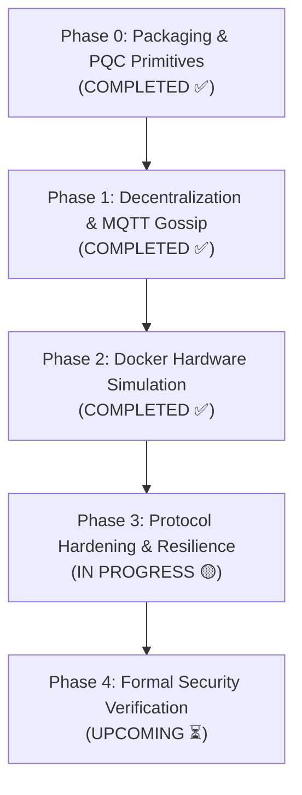

# Post-Quantum Cryptographic Drone Swarm — Journal Implementation & Architecture Plan

**Target Venues:** IEEE Transactions on Information Forensics and Security (TIFS) / IEEE TDSC / IEEE Internet of Things Journal  
**Repository:** `https://github.com/Aj-Shaer07/pqc.git`  
**Current Status:** Phase 0 & Phase 1 & Phase 2 Complete (✅), Phase 3 In Progress (🟡)  

---

## 🎯 Executive Summary & Purpose

This document provides the definitive technical roadmap for transitioning the **Post-Quantum Cryptographic (PQC) Drone Swarm Coordination & Threshold Authorization Framework** from an initial proof-of-concept into a fully distributed, hardware-simulated, and formally verified software architecture.

The system addresses the critical threat posed by quantum computers to unmanned aerial vehicle (UAV) mesh networks by synthesizing:
1. **Lattice-Based Post-Quantum Cryptography (Falcon-512)** for unforgeable, quantum-resistant digital signatures.
2. **Hardened Shamir's Secret Sharing ($(k, n)$ SSS)** for decentralized, fault-tolerant threshold key reconstruction.
3. **ChaCha20-Poly1305 AEAD** for authenticated symmetric payload confidentiality.
4. **Decentralized P2P Gossip & MQTT Communication** eliminating single-point-of-failure threshold engines.
5. **Multi-Container Docker Simulation** enforcing strict physical hardware resource constraints (CPU throttling, RAM limits).
6. **Formal Protocol Verification (BAN Logic & ProVerif/Tamarin)** under Dolev-Yao and Canetti-Krawczyk adversary models.

---

## 🏗️ Architectural Phases

---

### 📌 Phase 0: Code Modernization & Packaging (COMPLETED ✅)
Decomposed monolithic prototype (`implementation.py`) into an installable modular package (`pqc_swarm`):
- [x] **Falcon-512 Digital Signatures:** Packaged `tprest/falcon.py` into an installable Python module via `pyproject.toml`.
- [x] **CSPRNG Hardened SSS:** Replaced insecure polynomial RNG with `secrets.randbelow` and implemented Horner's method for polynomial evaluation over prime field $p = 2^{256} - 189$.
- [x] **ChaCha20-Poly1305 AEAD:** Wrapped authenticated symmetric encryption for mission command payloads.
- [x] **Package Structure:** Standardized layout under `src/pqc_swarm/` with top-level exports and comprehensive unit tests.
- [x] **Benchmarking Runner:** Created `run_simulation.py` covering $(3,5), (5,10), (10,20), (25,50)$ configurations.

---

### 🚀 Phase 1: Code Decoupling & Networking (COMPLETED ✅)
Eliminated centralized coordinators to achieve true peer-to-peer decentralized consensus:
- [x] **Decentralized Threshold Verification:** Embedded local threshold validation logic directly inside every `DroneNode`. Each drone tracks peer approvals and secret shares independently.
- [x] **MQTT P2P Gossip Transport:** Implemented `SwarmMQTTTransport` wrapper using `paho-mqtt` across dedicated topic channels:
  - `swarm/commands`: Ground Station mission command broadcasts.
  - `swarm/approvals`: Drone-to-drone peer signature gossip.
  - `swarm/shares`: Threshold secret share publication upon reaching $k$ approvals.
  - `swarm/registry`: Dynamic public key announcements and trust registry updates.
  - `swarm/telemetry`: Node execution acknowledgments and performance telemetry.
- [x] **Autonomous Daemons:** Created independent entry points:
  - `run_drone_node.py`: Autonomous drone daemon reacting to network events.
  - `run_ground_station.py`: Mission dispatcher and telemetry harvester.

---

### 🐳 Phase 2: Hardware Simulation via Docker (COMPLETED ✅)
Isolated nodes inside distinct network namespaces and simulated embedded UAV hardware constraints:
- [x] **Base Docker Image:** Lightweight `python:3.14-slim` container with pre-compiled cryptographic dependencies (`pycryptodome`, `cryptography`, `numpy`, `paho-mqtt`).
- [x] **Multi-Container Compose Topology (`docker-compose.yml`):**
  - $1\times$ Eclipse Mosquitto MQTT broker (`pqc_mqtt_broker`).
  - $1\times$ Ground Station node (`pqc_ground_station`).
  - $N\times$ Scalable Autonomous Drone containers (`pqc-drone-N`).
  - Isolated virtual bridge network (`swarm-net`).
- [x] **Hardware Resource Throttling:**
  - Configurable RAM limits (`128m`, `256m`, `512m`).
  - Configurable CPU throttling (`0.25`, `0.5`, `1.0` cores).
- [x] **CLI Swarm Controller (`docker_commands.sh`):**
  - Unified commands: `build`, `test`, `sim-single`, `sim-all`, `up [N] [MEM] [CPUS]`, `down`, `logs`.

---

### 🛡️ Phase 3: Protocol Hardening, Swarm Resilience & Metrics (IN PROGRESS 🟡)
Hardening the protocol against active network adversaries and instrumenting comprehensive empirical performance metrics:

#### 3.1 Anti-Replay Defense & Temporal Freshness (COMPLETED ✅)
- [x] **Sliding Freshness Window:** Rejects messages outside $\pm 5.0\text{s}$ window (`AntiReplayFilter`).
- [x] **Nonce & Identifier Caching:** Caches message nonces (`CMD:<cid>:<nonce>`) and peer approvals (`APP:<cid>:<drone_id>`) with automatic TTL pruning.
- [x] **Automated Unit Testing:** 100% test coverage validating acceptance of fresh packets and immediate rejection of stale or duplicate replay attempts.

#### 3.2 Broadcast Share Encryption (UP NEXT ⏳)
- [ ] **Wire Confidentiality on `swarm/shares`:** Encrypt Shamir shares $(x, y)$ using a pre-shared swarm mesh session key (ChaCha20-Poly1305 AEAD) or pairwise DH encapsulation.
- [ ] **Eavesdropping Prevention:** Ensures passive adversaries sniffing the MQTT bus cannot aggregate $k$ shares to reconstruct the mission key.

#### 3.3 Rogue Ground Station Defense & Geofencing
- [ ] **Autonomous Geofence Policies:** Drones independently evaluate waypoint coordinates against altitude and geographical bounding boxes, rejecting out-of-boundary commands regardless of valid GS signatures.
- [ ] **Multi-Operator Verification:** Require $M$-of-$N$ independent Ground Station Falcon signatures for high-impact payloads.

#### 3.4 Dynamic Swarm Membership & Revocation (CRL)
- [ ] **Signed Certificate Revocation Lists:** Ground Station broadcasts signed revocations over `swarm/registry`.
- [ ] **Dynamic Drone Onboarding:** Support onboarding replacement drones with fresh shares without altering the master mission key via Proactive Secret Sharing (PSS).

#### 3.5 Swarm Fault-Tolerance & Autonomous Return-to-Launch (RTL)
- [ ] **Liveness Tracking:** Heartbeat monitoring over `swarm/heartbeat` or telemetry.
- [ ] **Autonomous Fail-Safe:** If active responsive peers drop below $k$, drones trigger an emergency Return-to-Launch (RTL) protocol, zeroize transient mission keys, and abort.

#### 3.6 Performance Measurement & Telemetry Metrics (IN PROGRESS 🟡)
- [x] **Cryptographic Latency Profiling:** Instrument Falcon-512 signing/verification, SSS Lagrange reconstruction, and AEAD decryption durations per node.
- [x] **End-to-End Consensus Telemetry:** Measure duration from Ground Station dispatch $\to$ peer approvals $\to$ share exchange $\to$ execution, transmitted via `swarm/telemetry`.
- [ ] **Network & Bandwidth Overhead:** Measure wire payload sizes (Falcon public key ~897B, signature ~666B, ciphertext, encrypted shares) and traffic volume per topic.
- [ ] **Hardware Resource Profiling:** Benchmark CPU utilization spikes and RAM RSS (MB) under throttled Docker constraints (256m/512m RAM, 0.5/1.0 CPUs).
- [ ] **Automated Telemetry Aggregation:** Consolidate distributed metrics into exportable CSV/JSON reports.

---

### 🔬 Phase 4: Formal Security Verification & Robustness (UPCOMING ⏳)

#### 4.1 BAN Logic Mathematical Proof
- [ ] **Idealized Protocol Modeling:** Formalize Ground Station command issuance, peer approval gossip, and threshold share exchange into idealized message statements.
- [ ] **Logical Derivations:** Prove through BAN logic inference rules that honest drones achieve:
  $$\text{Drone}_i \models \text{GS} \mid\equiv \text{Command}$$
  $$\text{Drone}_i \models \sharp(\text{Command})$$
  $$\text{Drone}_i \models \text{Drone}_j \mid\equiv \text{Approval}$$

#### 4.2 Automated Symbolic Verification (ProVerif / Tamarin Prover)
- [ ] **Attacker Model:** Dolev-Yao network attacker capable of eavesdropping, intercepting, altering, and injecting messages on public channels.
- [ ] **Ephemeral Compromise:** Model Canetti-Krawczyk (CK) adversary with access to fewer than $k$ drone internal states.
- [ ] **Security Properties to Prove:**
  - **Secrecy / Confidentiality:** $\text{Attacker} \not\vdash \text{mission\_key}$ when $< k$ nodes compromised.
  - **Injective Agreement:** Strong mutual authentication between GS and Swarm.
  - **Unforgeability & Non-Frameability:** Adversary cannot forge valid approvals from honest drones.
  - **Replay Resistance:** Proof that replayed packets fail freshness verification.

#### 4.3 Post-Quantum Bit-Security Quantification
- [ ] **Lattice Hardness:** Quantify Falcon-512 Core-SVP bit-security ($> 128$ bits classical and quantum hardness via BKZ-2.0 lattice reduction simulation).
- [ ] **Comparative Analysis:** Benchmark key size, signature size, and computation times against classical schemes (RSA-2048, ECDSA P-256).

#### 4.4 Red-Team Adversarial Test Battery
- [ ] **Sybil Injection:** Injected rogue containers attempting unauthorized approval broadcasts.
- [ ] **MitM Tampering:** Bit-flipping ciphertext and AAD fields to verify AEAD integrity checks.
- [ ] **Byzantine Share Corruption:** Rogue nodes injecting corrupted Shamir shares $(x, y')$ to attempt denial-of-reconstruction.
- [ ] **Split-Brain & Drop-out Simulation:** Drop $N - k + 1$ containers simultaneously to verify autonomous abort and RTL behavior.

---

## 📑 Journal Paper Structural Outline

1. **Section I: Introduction**
   - Vulnerability of autonomous UAV swarms to quantum eavesdropping and Shor's algorithm.
   - Limitations of centralized ground stations and single-point-of-failure threshold engines.
   - Proposed decentralized PQC architecture contributions.
2. **Section II: System Architecture & Adversary Model**
   - UAV mesh network topology and MQTT gossip communication.
   - Formal adversary model: Dolev-Yao attacker with Byzantine node compromise ($< k$ threshold).
3. **Section III: Decentralized PQC Swarm Coordination Protocol**
   - Falcon-512 signature authentication.
   - Hardened Shamir Secret Sharing with CSPRNG.
   - ChaCha20-Poly1305 AEAD command execution.
4. **Section IV: Protocol Hardening & Autonomous Resilience**
   - Anti-replay defense and sliding temporal window.
   - Share broadcast confidentiality.
   - Autonomous geofencing and rogue GS defense.
   - Dynamic membership and fault-tolerant fail-safes (RTL).
5. **Section V: Formal Security Verification**
   - BAN Logic proof derivations.
   - ProVerif / Tamarin symbolic verification results.
   - Quantum bit-security and lattice reduction analysis.
6. **Section VI: Experimental Results & Benchmarks**
   - Docker container hardware simulation results.
   - Latency vs Swarm Size ($n \in \{5, 10, 20, 50\}$).
   - CPU and memory consumption under throttled conditions.
7. **Section VII: Conclusion & Future Work**
